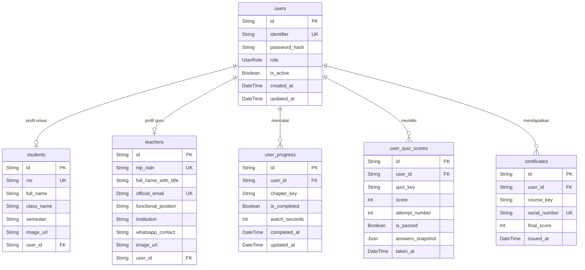

# 🗄️ Skema Prisma ORM — LMS MVP Amos Production
### Versi 2.0 — Revisi Efisiensi Budget & Timeline

> [!IMPORTANT]
> Dokumen ini adalah **revisi skema database v2**. Setelah efisiensi anggaran dan waktu, tabel berkurang dari 10 menjadi **6 tabel**. Konten kursus (bab, video, teks) dan soal kuis bersifat **hardcoded/statis** di dalam kode — tidak memerlukan tabel database.

---

## Perubahan dari Versi Sebelumnya

| Tabel | Status | Keterangan |
|---|---|---|
| `courses` | ❌ **Dihapus** | Konten kursus di-hardcode di codebase |
| `chapters` | ❌ **Dihapus** | Bab & video di-hardcode di codebase |
| `enrollments` | ❌ **Dihapus** | Semua siswa aktif otomatis mengakses semua kursus |
| `quizzes` | ❌ **Dihapus** | Soal kuis bersifat statis/hardcoded |
| `quiz_questions` | ❌ **Dihapus** | Soal kuis bersifat statis/hardcoded |
| `answer_options` | ❌ **Dihapus** | Jawaban kuis bersifat statis/hardcoded |
| `students` | ✅ **Baru** | Profil lengkap data siswa |
| `teachers` | ✅ **Baru** | Profil lengkap data guru/pengajar |
| `users` | ✏️ **Diperbarui** | Disederhanakan, hanya data autentikasi |
| `user_progress` | ✅ **Dipertahankan** | Melacak bab yang sudah diselesaikan siswa |
| `user_quiz_scores` | ✅ **Dipertahankan** | Menyimpan nilai kuis siswa |
| `certificates` | ✅ **Dipertahankan** | Data sertifikat yang sudah diterbitkan |

---

## Ringkasan Tabel Final (6 Tabel)

| # | Nama Tabel | Fungsi Utama |
|---|---|---|
| 1 | `users` | Data autentikasi semua pengguna (NIS/NIP, Password, Role) |
| 2 | `students` | Profil detail siswa (terhubung ke users via NIS) |
| 3 | `teachers` | Profil detail guru/admin (terhubung ke users via NIP/NIDN) |
| 4 | `user_progress` | Rekam jejak bab hardcoded mana yang sudah diselesaikan |
| 5 | `user_quiz_scores` | Nilai hasil kuis statis yang dikerjakan siswa |
| 6 | `certificates` | Data sertifikat kelulusan yang sudah diterbitkan |

---

## Diagram Entity-Relationship (ERD)



> [!NOTE]
> `chapter_key`, `quiz_key`, dan `course_key` adalah string identifikasi statis yang didefinisikan di dalam kode (contoh: `"beginner-ch-1"`, `"quiz-beginner-ch-1"`, `"course-beginner"`). Tidak ada lookup ke database untuk konten kursus.

---

## Detail Skema Per Tabel

### 1. `users` — Autentikasi Pengguna

```prisma
enum UserRole {
  SUPER_ADMIN
  GURU
  SISWA
}

model User {
  id            String    @id @default(cuid())
  identifier    String    @unique   // NIS untuk SISWA, NIP/NIDN untuk GURU & SUPER_ADMIN
  password_hash String
  role          UserRole  @default(SISWA)
  is_active     Boolean   @default(true)

  created_at    DateTime  @default(now())
  updated_at    DateTime  @updatedAt

  // Relasi profil (one-to-one)
  student       Student?
  teacher       Teacher?

  // Relasi aktivitas
  progress      UserProgress[]
  quiz_scores   UserQuizScore[]
  certificates  Certificate[]

  @@map("users")
}
```

> [!NOTE]
> Field `identifier` bersifat polymorphic — berisi **NIS** untuk siswa dan **NIP/NIDN** untuk guru & super admin. Login siswa menggunakan NIS, sedangkan guru menggunakan email (disimpan di tabel `teachers` dan di-resolve saat login). Password selalu di-hash dengan **bcrypt**.

---

### 2. `students` — Profil Siswa

```prisma
model Student {
  id          String  @id @default(cuid())
  nis         String  @unique               // Nomor Induk Siswa (*)
  full_name   String                        // Nama Lengkap (*)
  class_name  String                        // Kelas, contoh: "8A", "9B"
  semester    String                        // Contoh: "Ganjil 2024/2025"
  image_url   String?                       // URL foto profil siswa

  user_id     String  @unique
  user        User    @relation(fields: [user_id], references: [id], onDelete: Cascade)

  @@map("students")
}
```

---

### 3. `teachers` — Profil Guru / Admin

```prisma
model Teacher {
  id                    String  @id @default(cuid())
  nip_nidn              String  @unique       // NIP atau NIDN (*)
  full_name_with_title  String               // Nama + gelar, contoh: "Dr. Budi Santoso, M.Pd." (*)
  official_email        String  @unique       // Email resmi institusi (*)
  functional_position   String?              // Jabatan fungsional, contoh: "Guru Mapel IPA"
  institution           String?              // Asal sekolah/institusi mitra
  whatsapp_contact      String?              // Nomor WhatsApp untuk konsultasi siswa
  image_url             String?              // URL foto profil guru

  user_id               String  @unique
  user                  User    @relation(fields: [user_id], references: [id], onDelete: Cascade)

  @@map("teachers")
}
```

---

### 4. `user_progress` — Progress Bab Siswa (Hardcoded)

```prisma
model UserProgress {
  id           String    @id @default(cuid())
  user_id      String
  user         User      @relation(fields: [user_id], references: [id], onDelete: Cascade)

  chapter_key  String                        // Key statis dari kode, contoh: "beginner-ch-1"
  is_completed Boolean   @default(false)
  watch_seconds Int      @default(0)         // Akumulasi detik menonton
  completed_at DateTime?
  updated_at   DateTime  @updatedAt

  @@unique([user_id, chapter_key])           // Satu record per siswa per bab
  @@map("user_progress")
}
```

---

### 5. `user_quiz_scores` — Nilai Kuis Siswa (Soal Statis)

```prisma
model UserQuizScore {
  id              String    @id @default(cuid())
  user_id         String
  user            User      @relation(fields: [user_id], references: [id], onDelete: Cascade)

  quiz_key        String                      // Key statis dari kode, contoh: "quiz-beginner-ch-1"
  score           Int                         // Nilai 0–100
  attempt_number  Int       @default(1)       // Percobaan ke-berapa
  is_passed       Boolean   @default(false)
  answers_snapshot Json                       // Snapshot jawaban siswa untuk audit guru
  taken_at        DateTime  @default(now())

  @@map("user_quiz_scores")
}
```

> [!CAUTION]
> Kunci jawaban kuis yang di-hardcode **harus disimpan di Server Action / environment variable**, bukan di kode klien. Proses grading wajib selalu terjadi di sisi server.

---

### 6. `certificates` — Sertifikat Kelulusan

```prisma
model Certificate {
  id            String    @id @default(cuid())
  user_id       String
  user          User      @relation(fields: [user_id], references: [id])

  course_key    String                        // Key kursus statis, contoh: "course-beginner"
  serial_number String    @unique             // Format: AMOS-2025-XXXXX (auto-generate)
  final_score   Int                           // Nilai akhir saat sertifikat diterbitkan
  issued_at     DateTime  @default(now())

  @@unique([user_id, course_key])             // Satu sertifikat per kursus per siswa
  @@map("certificates")
}
```

---

## Konvensi Static Key (Hardcoded Content)

Karena konten kursus tidak tersimpan di database, seluruh tim harus sepakat menggunakan konvensi penamaan key yang konsisten:

```typescript
// constants/curriculum.ts (contoh implementasi nanti)

export const COURSE_KEYS = {
  BEGINNER: "course-beginner",
  INTERMEDIATE: "course-intermediate",
} as const;

export const CHAPTER_KEYS = {
  BEGINNER_CH1: "beginner-ch-1",
  BEGINNER_CH2: "beginner-ch-2",
  // dst...
} as const;

export const QUIZ_KEYS = {
  QUIZ_BEGINNER_CH1: "quiz-beginner-ch-1",
  // dst...
} as const;
```

---

## Ringkasan Relasi Antar Tabel

```
users ──< user_progress    (melacak bab selesai berdasarkan chapter_key)
users ──< user_quiz_scores (menyimpan nilai kuis berdasarkan quiz_key)
users ──< certificates     (menyimpan sertifikat berdasarkan course_key)
users ──| students         (profil detail siswa, one-to-one)
users ──| teachers         (profil detail guru, one-to-one)
```

## Keputusan Desain Utama

| Keputusan | Alasan |
|---|---|
| Konten kursus & kuis di-hardcode | Menghemat waktu dev & biaya DB query; cocok untuk kurikulum statis satu topik |
| `identifier` polymorphic di `users` | Satu tabel autentikasi untuk NIS (siswa) dan NIP/NIDN (guru), menyederhanakan session |
| `chapter_key` & `quiz_key` sebagai string | Menghubungkan data DB dengan konten statis tanpa foreign key ke tabel kursus |
| Profil siswa & guru dipisah dari `users` | Memisahkan concern: `users` = auth, `students`/`teachers` = data domain |
| `answers_snapshot` tetap dipertahankan | Guru tetap bisa mengaudit jawaban siswa meski soal statis |
| `onDelete: Cascade` pada semua relasi user | Hapus user = hapus semua data terkait secara otomatis |

---

*Revisi v2 — 4 Oktober 2025. Skema ini siap dijadikan basis file `schema.prisma` pada sprint Minggu 2.*
