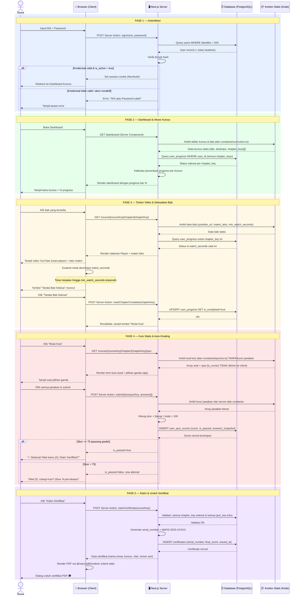
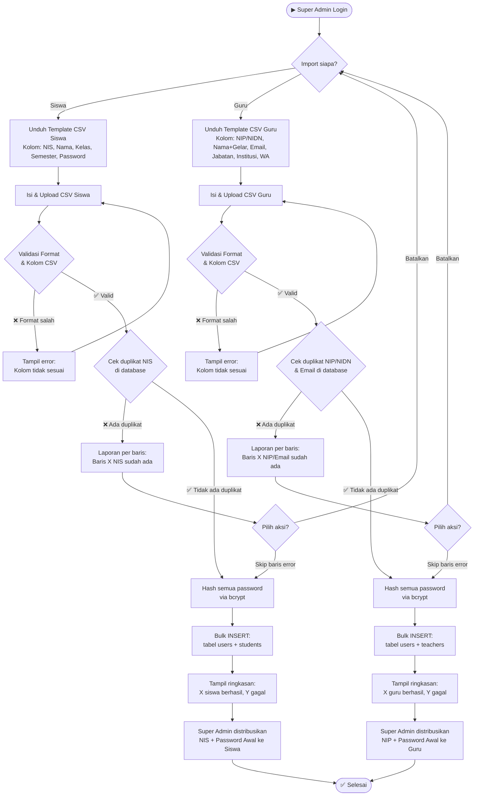
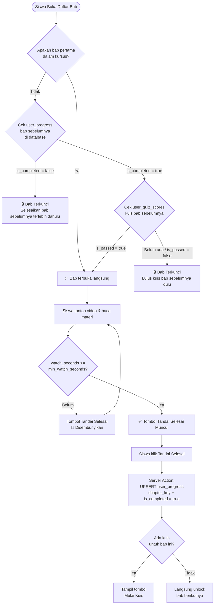

# 📐 Diagram Sistem — LMS MVP Amos Production
### Versi 2.0 — Revisi 4 Aktor & Konten Statis

> [!NOTE]
> Dokumen ini mencakup 4 diagram utama yang telah diperbarui: **Use Case Diagram** (4 aktor), **Sequence Diagram** alur belajar siswa, **Activity Flowchart** alur Admin bulk import, dan **Flowchart** mekanisme Progress Lock.

---

## 1. Use Case Diagram

> Menggambarkan seluruh fitur yang dapat diakses oleh masing-masing dari **4 aktor** sistem.

```mermaid
flowchart TB
    subgraph AKTOR["🧑‍🤝‍🧑 Aktor Sistem"]
        G["👨‍🏫 Guru"]
        S["👨‍🎓 Siswa"]
        GS["🌐 Guest\n(Pengunjung Umum)"]
        SA["🛡️ Super Admin"]
    end

    subgraph GUEST_AREA["🌐 Akses Terbuka (Tanpa Login)"]
        UC_G1["Lihat Landing Page"]
        UC_G2["Lihat Knowledge Page\n(Artikel / Info AI)"]
    end

    subgraph SISWA_AREA["📱 Portal Siswa"]
        UC_S1["Login via NIS & Password"]
        UC_S2["Lihat Dashboard Kursus"]
        UC_S3["Baca Materi Teks & Tonton Video"]
        UC_S4["Kerjakan Kuis Pilihan Ganda"]
        UC_S5["Lihat Hasil & Nilai Kuis"]
        UC_S6["Lihat Progress Belajar\ndan Akses Bab Selanjutnya"]
        UC_S7["Unduh Sertifikat PDF"]
        UC_S8["Management Profile Siswa"]
    end

    subgraph GURU_AREA["🖥️ Portal Guru"]
        UC_T1["Login via NIP & Password"]
        UC_T2["CRUD Akun Siswa Manual\n(Tambah, Edit, Hapus)"]
        UC_T3["Pantau Progress Siswa\n(Laporan Nilai & Penyelesaian)"]
        UC_T4["Management Profile Guru"]
    end

    subgraph SUPERADMIN_AREA["🛡️ Portal Super Admin\n(Semua fitur Guru +)"]
        UC_SA1["Import Massal Siswa\n(Bulk CSV)"]
        UC_SA2["Import Massal Guru\n(Bulk CSV)"]
        UC_SA3["Kelola Akun Guru\n(CRUD)"]
    end

    GS --> UC_G1
    GS --> UC_G2

    S --> UC_S1
    S --> UC_S2
    S --> UC_S3
    S --> UC_S4
    S --> UC_S5
    S --> UC_S6
    S --> UC_S7
    S --> UC_S8

    G --> UC_T1
    G --> UC_T2
    G --> UC_T3
    G --> UC_T4

    SA --> UC_T1
    SA --> UC_T2
    SA --> UC_T3
    SA --> UC_T4
    SA --> UC_SA1
    SA --> UC_SA2
    SA --> UC_SA3
```

---

## 2. Sequence Diagram — Alur Belajar Siswa (End-to-End)

> Menggambarkan interaksi antara **Siswa**, **Browser/Client**, **Server (Next.js Server Actions)**, dan **Database** — dengan konten kursus & soal kuis yang bersifat **statis/hardcoded**.

---

## 3. Activity Flowchart — Alur Super Admin: Import Massal (Siswa & Guru)

> Super Admin dapat mengimpor banyak akun siswa **dan** guru sekaligus melalui CSV.

---

## 4. Flowchart — Mekanisme Progress Lock Bab (Konten Statis)

> Logika kapan siswa boleh mengakses bab berikutnya berdasarkan kunci statis dari `constants/curriculum.ts`.

---

## Ringkasan Hak Akses Per Aktor

| Fitur | 🌐 Guest | 👨‍🎓 Siswa | 👨‍🏫 Guru | 🛡️ Super Admin |
|---|:---:|:---:|:---:|:---:|
| Landing Page | ✅ | ✅ | ✅ | ✅ |
| Knowledge Page | ✅ | ✅ | ✅ | ✅ |
| Login | — | ✅ NIS | ✅ **NIP** | ✅ NIP |
| Dashboard Kursus | — | ✅ | — | — |
| Baca Materi & Video | — | ✅ | — | — |
| Kerjakan Kuis | — | ✅ | — | — |
| Lihat Hasil Kuis | — | ✅ | — | — |
| Lihat Progress & Akses Bab Selanjutnya | — | ✅ | — | — |
| Unduh Sertifikat PDF | — | ✅ | — | — |
| Management Profile Siswa | — | ✅ | — | — |
| Pantau Progress Siswa | — | — | ✅ | ✅ |
| CRUD Siswa Manual | — | — | ✅ | ✅ |
| Management Profile Guru | — | — | ✅ | ✅ |
| Kelola Akun Guru | — | — | — | ✅ |
| Import Massal Siswa CSV | — | — | — | ✅ |
| Import Massal Guru CSV | — | — | — | ✅ |

---

*Revisi v3 — 5 Oktober 2025. Diagram ini menjadi acuan tim developer sebelum memasuki fase coding (Minggu 2).*

---

*Revisi v2 — 4 Oktober 2025. Diagram ini menjadi acuan tim developer sebelum memasuki fase coding (Minggu 2).*
